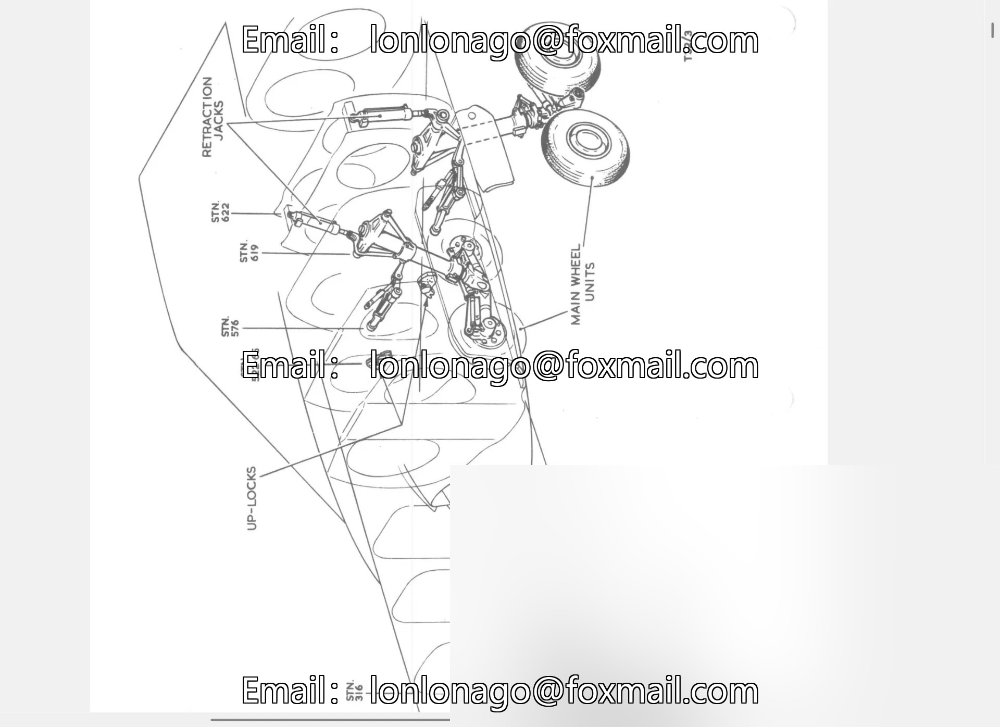
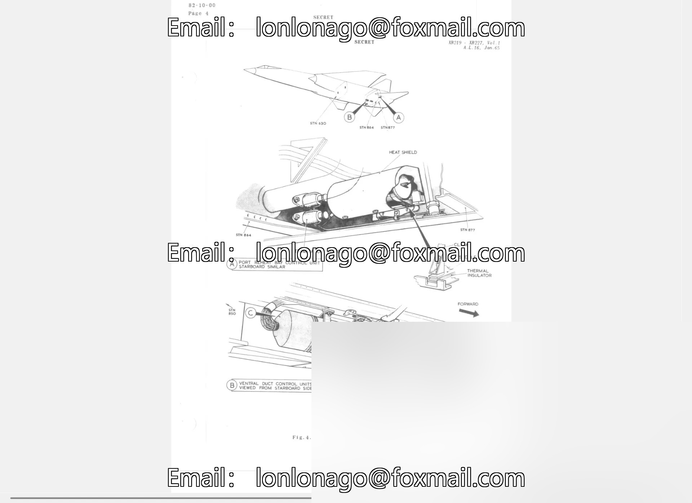
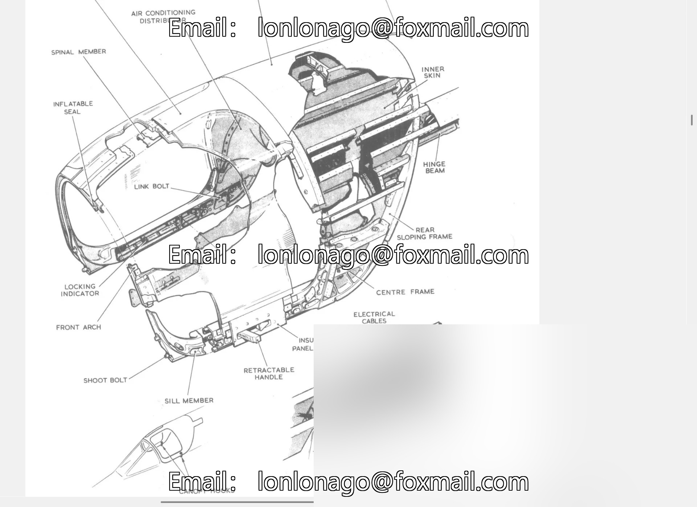
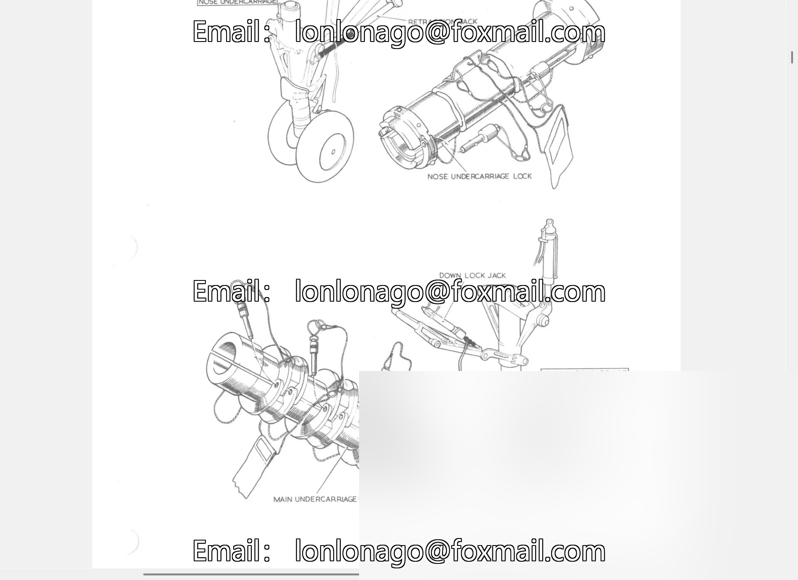
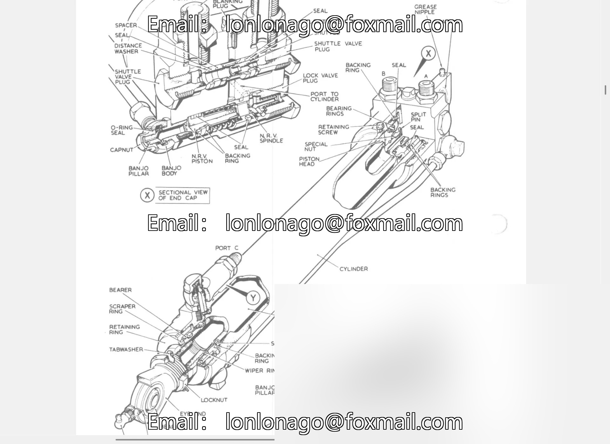
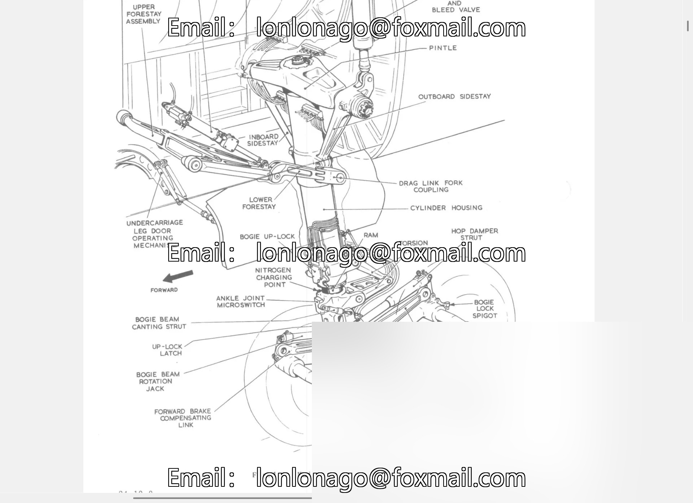
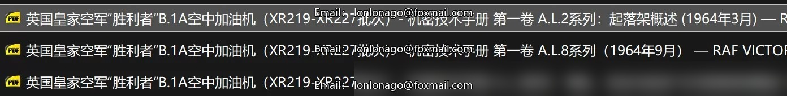

# The confidential technical manual, volume 3, of the RAF "Victor" B.1A aerial refueling aircraft.

## Body

The three volume confidential technical manuals of the Royal British Air Force "Victory" B.1A aerial refueling aircraft, approximately 1900 pages

Aircraft model: "Victorious" (B.1A) is a strategic bomber and aerial refueling aircraft used by the Royal Air Force of the UK during the Cold War. It was developed by Handley Page Company and is mainly used for long-range combat and aerial refueling tasks.

Manual importance: These technical manuals are confidential documents that meticulously record details of aircraft design, operation, and maintenance, and hold important reference value for aviation history research, military enthusiasts, or technical restoration.

Time background: The manual from 1964 reflects the technical state and upgrades of this model in the 1960s, especially the improved version of the B.1A model.

These are confidential 3-volume technical manuals, approximately 1,900 pages, covering aircraft design, operations and maintenance details.

<!-- AI_ENRICHED -->

## Images

## Payment

Here is a pay link on Stripe ( https://buy.stripe.com/3cs8yP7sY87d0vu9AB ). Please contact me lonlonago@foxmail.com after funding $89, and I will send you a complete data files , thank you!

